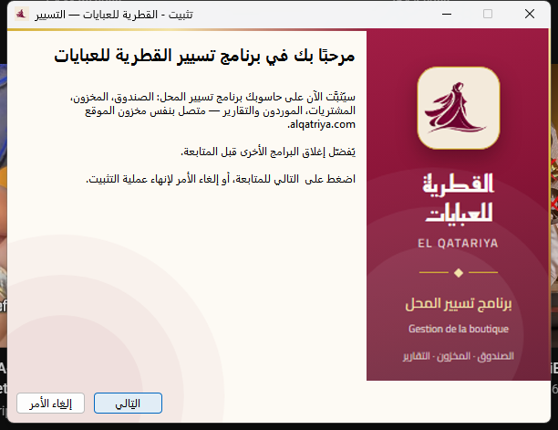

# القطرية للعبايات — برنامج التسيير (Windows)

برنامج تسيير محل [القطرية للعبايات](https://alqatriya.com): الصندوق، المخزون،
المشتريات، الموردون، إغلاق الصندوق والتقارير — مربوط بنفس مخزون الموقع.

**[⬇ تحميل البرنامج (Windows)](https://github.com/riadmca/alqatriya-gestion/releases/latest/download/ElQatariya-Gestion-Setup.exe)**

## التثبيت
1. حمّل `ElQatariya-Gestion-Setup.exe` وشغّله.
2. إن ظهرت رسالة «Windows a protégé votre ordinateur»: اضغط
   «Informations complémentaires» ثم «Exécuter quand même» (الملف غير موقّع
   رقميًا بعد).
3. اتبع خطوات التثبيت، ثم سجّل الدخول بحسابك (المدير أو البائعة).

Windows 10 / 11، 64 بت. لا يحتاج صلاحيات المدير.

هذا المستودع يحمل ملف التثبيت والإصدارات فقط.
